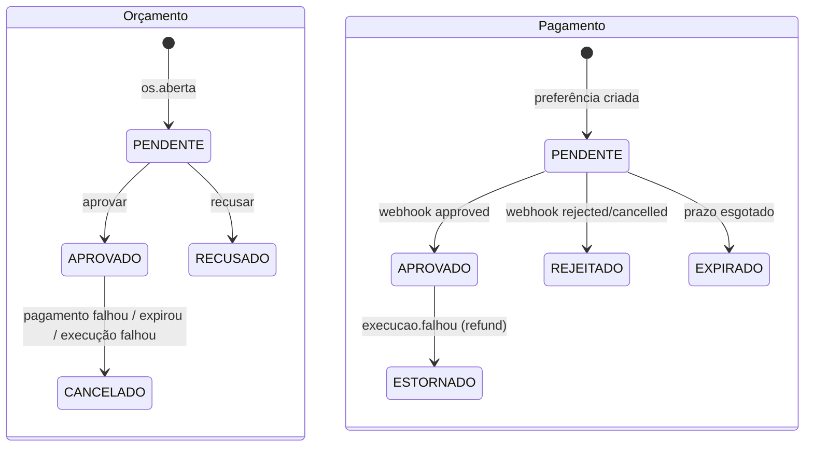

# Contratos de eventos — Billing Service

O Billing participa da saga coreografada da oficina. Ele cuida do orçamento, da aprovação do cliente e do pagamento no Mercado Pago. A infraestrutura de mensageria e as garantias (envelope, outbox, idempotência, retry e DLQ) são as mesmas de todos os serviços e estão descritas em `TechChallengerFiap-Application/docs/eventos.md`.

| Item | Valor |
|---|---|
| Exchange | `oficina.events` (topic). A routing key é o `type` |
| Fila do Billing | `billing-service.events` (+ `.retry` com TTL e `.dlq`) |
| `source` dos eventos publicados | `billing-service` |
| `correlationId` | o `osId` |

## Eventos consumidos

| Evento | De | O que o Billing faz |
|---|---|---|
| `os.aberta` | OS Service | Cria o orçamento **PENDENTE** com os itens da OS, publica `orcamento.gerado` e envia o e-mail com os links de aprovar e recusar. Se a OS não pode ser orçada (sem itens, sem e-mail, valor divergente), publica `orcamento.falhou`. |
| `execucao.falhou` | Execution | **Compensação:** estorna o pagamento aprovado no Mercado Pago (reembolso total, idempotência pelo `eventId`), cancela o orçamento e publica `pagamento.estornado`. |

Se `os.aberta` chegar sem `cliente.email`, o Billing busca a OS em `GET /internal/os/:id` no OS Service, com o `x-service-token`.

## Eventos publicados

### `orcamento.gerado`
```json
{ "osId": 42, "orcamentoId": 7, "valorTotal": 180, "quantidadeItens": 2,
  "linkAprovacao": "https://<alb>/orcamentos/7/decisao?acao=aprovar&token=..." }
```

### `orcamento.falhou` (compensação)
```json
{ "osId": 42, "motivo": "OS sem serviços ou peças para orçar" }
```

### `orcamento.aprovado`
Publicado quando o cliente aprova, depois de criar a preferência (Checkout Pro) no Mercado Pago.
```json
{ "osId": 42, "orcamentoId": 7, "pagamentoId": 3, "valorTotal": 180 }
```

### `orcamento.recusado` (compensação)
```json
{ "osId": 42, "orcamentoId": 7, "motivo": "achou caro" }
```

### `pagamento.confirmado`
Publicado pelo webhook depois de consultar `GET /v1/payments/:id` (status `approved`). Leva os itens para o Execution montar a fila sem chamada síncrona.
```json
{ "osId": 42, "orcamentoId": 7, "pagamentoId": 3, "mpPaymentId": "1234567890", "valor": 180,
  "servicos": [{ "servicoId": 1, "nome": "Troca de óleo", "quantidade": 1 }],
  "pecas": [{ "pecaId": 4, "nome": "Filtro", "quantidade": 2 }] }
```

### `pagamento.falhou` (compensação)
Pagamento `rejected`/`cancelled` no MP, ou não concluído dentro de `PAYMENT_EXPIRATION_MINUTES` (padrão 24 h). O orçamento vai para CANCELADO.
```json
{ "osId": 42, "orcamentoId": 7, "pagamentoId": 3, "motivo": "Pagamento rejected (cc_rejected_insufficient_amount)" }
```

### `pagamento.estornado`
Estorno feito pela compensação de `execucao.falhou`, ou direto no painel do MP (`origem: "mercadopago"`).
```json
{ "osId": 42, "orcamentoId": 7, "pagamentoId": 3, "valor": 180, "mpRefundId": "555", "motivo": "Falha na execução: peça indisponível" }
```

## Estados



## Mercado Pago

- SDK oficial `mercadopago` v2. As chamadas são `Preference.create` (Checkout Pro, `external_reference = orcamentoId`), `Payment.get` no webhook (o status real vem da API, não do corpo da notificação) e `PaymentRefund.total` na compensação.
- O webhook valida o header `x-signature`: HMAC-SHA256 com `MP_WEBHOOK_SECRET` sobre `id:<data.id>;request-id:<x-request-id>;ts:<ts>;`. Assinatura inválida responde 401, e pagamento desconhecido responde 200 para o MP não reenviar.
- Idempotência no MP: `preferencia-orcamento-<id>` na preferência e `estorno-<eventId>` no reembolso.
- Antes de confirmar, o valor (`transaction_amount`, tolerância de R$ 0,01) e a moeda (`BRL`) do pagamento no MP precisam bater com o orçamento. Se divergirem, o pagamento fica PENDENTE, nenhum evento é publicado e é registrado o alerta `PagamentoDivergente` (log e New Relic) para revisão manual.
- `MP_NOTIFICATION_URL=painel` (padrão nos manifests): as preferências não levam `notification_url` e o MP avisa pelo webhook configurado em *Suas integrações*. Os avisos da `notification_url` da preferência chegam também no formato IPN (`?topic=&id=`), que o Billing responde com 200 e ignora.

### Assinatura do webhook em produção x sandbox
`MP_WEBHOOK_SIGNATURE=enforce` (padrão) recusa avisos com assinatura inválida (401). Nos testes com **contas de teste** do Mercado Pago (vendedor e comprador de teste, credenciais `APP_USR` de usuário de teste), os avisos **automáticos** dos pagamentos não validaram com nenhuma chave exibida no painel, enquanto as simulações do painel validaram. Para esse sandbox existe `MP_WEBHOOK_SIGNATURE=warn`: a assinatura inválida vira alerta (`WebhookAssinaturaInvalida` no New Relic) e o aviso segue. Isso não permite aprovar um pagamento falso, porque o Billing ignora o corpo do aviso e decide apenas pelo `GET /v1/payments/:id` com o access token (status, valor, moeda e `external_reference`). **Em produção, use sempre `enforce`.**
- `MERCADOPAGO_MODE=fake` troca o gateway por um simulado, para rodar local e nos testes de ponta a ponta sem credenciais. O id do pagamento `fake-<orcamentoId>-<status>` define o resultado.
